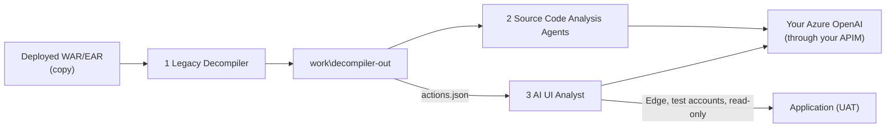

# Handover guide: analysing your legacy application with the modernisation toolkit

This guide takes you from receiving the toolkit to reviewing the analysis of your own application. Follow the phases in order. Each phase ends with a checkpoint; do not continue until it passes.

| Phase | What happens | Who | Typical duration |
|---|---|---|---|
| [0. Prepare](#phase-0-prepare) | Collect information, approvals and accounts | Project lead, APIM team, server admin, security | 1–5 days (mostly waiting for approvals) |
| [1. Install](#phase-1-download-verify-and-install) | Download, transfer, verify and extract the release | Operator | 30 min |
| [2. Connect to Azure OpenAI](#phase-2-connect-to-azure-openai-through-api-management) | Configure and test the model access through APIM | Operator + APIM team | 30 min |
| [3. Legacy Decompiler](#phase-3-legacy-decompiler) | Extract evidence and reconstruct source from the deployed archive | Operator | 15 min – 2 h |
| [4. Source Code Analysis Agents](#phase-4-source-code-analysis-agents) | AI analysis of the code: architecture, rules, findings, migration plan | Operator | 1 h – 2 days (depends on size and quota) |
| [5. AI UI Analyst](#phase-5-ai-ui-analyst) | AI exploration of the user interface per role; UI design analysis | Operator + application owner | 1–8 h per run |
| [6. Review results](#phase-6-review-the-results) | Read the reports, validate findings with the application experts | Architects, application owner | as needed |
| [7. Close down](#phase-7-close-down) | Rotate the key, archive or delete outputs | Operator, security | 30 min |

Conventions:
- `D:\modernisation` is the installation folder used in all examples. Any folder works; keep the path short.
- Commands are PowerShell, run from `D:\modernisation` unless stated otherwise.
- `<…>` marks a value you must replace.

---

## The toolkit in one page

Three tools, run on one Windows x64 machine (the application server itself, or any VM that can reach the application and the Azure OpenAI endpoint):

| Tool | Input | Output | Uses AI | Network |
|---|---|---|---|---|
| **Legacy Decompiler** (`legacy-decompiler.exe`) | A copy of the deployed WAR/EAR | Reconstructed Java source from three decompilers with fidelity scores; inventory, configuration (secrets masked), SQL, integrations, entry points, Struts actions, validation rules, ORM mapping, dead code | No | None (fully offline) |
| **Source Code Analysis Agents** (`code-analyst.exe`) | Decompiler output, and/or the original source when available | Modernisation report: architecture, per-component assessment and strategy, verified business rules, security/reliability findings with CWE ids, target architecture and migration waves | Yes | Azure OpenAI / APIM endpoint only |
| **AI UI Analyst** (`ui-analyst.exe`) | The UAT URL and one test account per role | Screen inventory with screenshots, navigation graph, role-access matrix, blocked (data-changing) actions, UI design and accessibility analysis mapped to a target design system | Yes | The UAT application and the Azure OpenAI / APIM endpoint |



**What the toolkit analyses.** Java web applications (WAR, or EAR containing WARs) based on servlets and JSP. The deepest deterministic extraction covers Struts 1, Spring XML configuration, Hibernate / JPA, Quartz and `web.xml`. Applications on other Java frameworks are still decompiled and analysed by the AI agents, with fewer deterministic extractions. The UI Analyst works with any browser-based application.

**What never happens.** The tools do not install anything on the application, do not change its data (read-only mode by default), do not send content anywhere except your own Azure OpenAI / APIM endpoint, and do not use GitHub accounts. Passwords and keys are never written to files.

---

## Phase 0: Prepare

Send the checklists below to the people concerned at the start; most of the elapsed time is spent waiting for answers and approvals.

### 0.1 Machine that runs the tools

| Item | Requirement | ✔ |
|---|---|---|
| Operating system | Windows Server 2019/2022 or Windows 10/11, **x64** (validated on Windows 11 x64). For the UI Analyst: Desktop Experience (a browser is needed). | ☐ |
| Resources (guidance) | 2 vCPU and 4 GB free RAM minimum; 4 vCPU / 8–16 GB recommended. Run the tools **one at a time**. | ☐ |
| Disk | About 30 × the size of the WAR/EAR for the decompiler, plus about 1 GB for the tools and 1 GB for UI screenshots. | ☐ |
| User account | A named Windows account that can sign in interactively (console or RDP). **No administrator rights are needed** to run the tools. | ☐ |
| Long paths (recommended) | `HKLM\SYSTEM\CurrentControlSet\Control\FileSystem\LongPathsEnabled = 1` (administrator, once). Otherwise keep the installation path short. | ☐ |
| Microsoft Edge | Installed (needed only for the UI Analyst). | ☐ |
| Java | See 0.2. | ☐ |
| Network | HTTPS (443) to the APIM gateway; HTTP(S) to the UAT application URL. **No other internet access is needed.** | ☐ |

If the application server is under business load, run the tools outside business hours, or use another VM in the same network.

### 0.2 Java for the Legacy Decompiler

| Option | Result | Effort |
|---|---|---|
| **Portable JDK 17 or 21** (recommended) — the ZIP of [Microsoft Build of OpenJDK](https://learn.microsoft.com/java/openjdk/download) or [Eclipse Temurin](https://adoptium.net/temurin/releases/), unzipped to e.g. `D:\modernisation\jdk17` | All three decompilers, recompilation check, dependency analysis | No installer, no administrator rights |
| The server's existing **JDK 8** | Two decompilers (CFR, Procyon); recompilation check and dependency analysis work | None |
| The server's existing **JRE 8** (no `javac`) | Two decompilers; recompilation check and dependency analysis are skipped (reported) | None |

Optional: a JDK 8 in addition to JDK 17 (`jdk.recompile_home`) measures recompilation fidelity at the application's original Java level.

### 0.3 Questions for the APIM / Azure OpenAI team

The two AI tools call your Azure OpenAI deployment through API Management. Send these questions to the team that owns APIM; their answers map one-to-one to the configuration in Phase 2.

| # | Question | Example answer | Goes into |
|---|---|---|---|
| 1 | What is the **Base URL** of the Azure OpenAI API in APIM (APIM portal → APIs → the API → Settings)? | `https://apim-contoso.azure-api.net/aoai/openai` | `ai.endpoint` |
| 2 | Was the API imported in the **classic Azure OpenAI** form (`/openai/deployments/{deployment-id}/…?api-version=…`) or the **Azure OpenAI v1** form (`/openai/v1/…`)? | classic | `ai.api_style` |
| 3 | What is the **subscription key header name** of this API (Settings → Subscription → Header name)? | `api-key` or `Ocp-Apim-Subscription-Key` | `ai.auth_header` |
| 4 | Please issue a **subscription key** for a product that contains this API, for the duration of the analysis. | (secret) | environment variable `AZURE_OPENAI_API_KEY` |
| 5 | Which **deployment name(s)** are routed? We need a model with **image input and JSON-schema (structured) output** for the UI Analyst, and **function/tool calling** for the Code Analyst. A reasoning-capable GPT model covers both. | `gpt-4.1`, `gpt-5-mini` | `ai.model` |
| 6 | Does the API expose **`POST /openai/deployments/{id}/chat/completions`** *and* **`POST /openai/responses`**? The Code Analyst needs `/responses` with reasoning models. | yes / add it | `analysis.wire_api` |
| 7 | Which **api-version** is accepted? | `2025-04-01-preview` | `ai.api_version` |
| 8 | What **token-per-minute and request-size limits** apply? The UI Analyst sends screenshots (up to ~1 MB per call); the Code Analyst sends large prompts (up to ~100K tokens). | 100K TPM, 10 MB | sizing, `--only` batches |
| 9 | Is **request/response body logging** enabled (Application Insights, Log Analytics, event hub)? If yes, source code and screen content would be copied into those logs. | no / disable for this API | data owner decision |
| 10 | Is the gateway certificate issued by an **internal CA**, or is there **TLS inspection** or an **outbound proxy** on the path from our server? | internal CA, no proxy | Phase 2.4 |
| 11 | Is the gateway reachable from our server (firewall / private DNS)? | yes | Phase 2.5 test |

### 0.4 The application artefact (for the Decompiler)

Ask the application server administrator for a **read-only copy of exactly what is deployed**:

1. Locate the deployed archive:

   | Application server | Typical location |
   |---|---|
   | Apache Tomcat | `%CATALINA_BASE%\webapps\<app>.war`, or the exploded folder `webapps\<app>\` |
   | Oracle WebLogic | Console → Deployments → *Source Path* (or `config.xml` → `<app-deployment><source-path>`) |
   | IBM WebSphere | `<profile>\installedApps\<cell>\<app>.ear` |
   | JBoss / WildFly | `standalone\deployments\` |

2. Copy the WAR/EAR **as deployed** (not a build-server version). Include `WEB-INF\lib`. If business code is in shared server libraries (for example a custom JAR in Tomcat `lib\`), copy those JARs too and place them in `WEB-INF\lib` of the copy.
3. If only an exploded folder exists, copy the folder and repackage it with any JDK: `jar --create --file D:\modernisation\input\app.war -C <copied-folder> .`
4. Record the hash on both sides: `Get-FileHash <archive> -Algorithm SHA256`.
5. Note, for the modernisation team: application server product and version, JVM version, context path, and server-level configuration outside the archive (data sources, `context.xml` / `server.xml`, schedulers, queues), with secrets removed.

### 0.5 UAT environment and test accounts (for the UI Analyst)

| Item | Requirement | ✔ |
|---|---|---|
| Environment | A **non-production** instance (UAT/SIT) with masked personal data. **Never production.** | ☐ |
| URLs | Application base URL and sign-in page URL. | ☐ |
| Roles | The list of business roles to analyse (for example operator, approver, supervisor, administrator). | ☐ |
| Test accounts | **One account per role**, with exactly that role's access, **without MFA and CAPTCHA**, not used by people during the run (parallel sessions can log each other out). For SSO / Windows Integrated Authentication: one Windows account per role. | ☐ |
| Lockout | Known lockout threshold (`check` signs in once per role). | ☐ |
| Search values | A few valid identifiers that search screens accept (for example customer or order numbers), so screens behind a search can be reached. | ☐ |
| Browser compatibility | Does the application work in **modern Edge**, or only in **Internet Explorer**? (IE-only needs a one-time administrator setup; see 5.2.) | ☐ |

### 0.6 Approvals

| Approval | Why | Owner | ✔ |
|---|---|---|---|
| Running unsigned executables | `legacy-decompiler.exe`, `code-analyst.exe`, `ui-analyst.exe`, `copilot-runtime.exe` (and `IEDriverServer.exe` for IE mode). If AppLocker/WDAC is enforced, allow them by path or hash; `SHA256SUMS.txt` lists every hash. | Security | ☐ |
| Antivirus exclusion (recommended) | The decompiler writes thousands of small files to `D:\modernisation\work`. | Security | ☐ |
| Data to Azure OpenAI | Decompiled/original source (secrets and card-number patterns masked) and UAT screen content/screenshots are sent to **your** Azure OpenAI deployment. Its region / data zone determines residency. | Data owner | ☐ |
| Confidential outputs | Decompiled source and reports are the application owner's intellectual property. Restrict NTFS permissions on `D:\modernisation\work`. | Data owner | ☐ |
| Third-party components | The release bundles open-source decompilers (Vineflower, CFR, Procyon — Apache 2.0 / MIT), Selenium IEDriverServer, Playwright, and the GitHub Copilot SDK runtime (used only as a local agent runtime, inference goes to your deployment, telemetry off). Review the GitHub Copilot SDK terms if your policy requires it. | Legal / security | ☐ |

**Checkpoint 0:** all boxes ticked, APIM answers received, artefact copied with matching hashes, test accounts working in a browser.

---

## Phase 1: Download, verify and install

### 1.1 Download (on a workstation with internet access)

1. Open the repository's **Releases** page and download `legacy-app-analyzer-release-<date>.zip` from the latest release.
2. Compare its hash with the **Zip SHA-256** in the release notes:

   ```powershell
   Get-FileHash .\legacy-app-analyzer-release-<date>.zip -Algorithm SHA256
   ```

3. Transfer the zip to the target machine through your approved channel.

Alternative: build the same release yourself on a connected Windows machine with Python 3.12 x64 — clone the repository and run `.\build-release.ps1`; the result is in `release\`.

### 1.2 Unblock, extract and verify (on the target machine)

```powershell
Unblock-File .\legacy-app-analyzer-release-<date>.zip          # otherwise Windows may block every extracted exe
Expand-Archive .\legacy-app-analyzer-release-<date>.zip -DestinationPath D:\
Rename-Item D:\legacy-app-analyzer-release modernisation
cd D:\modernisation
$bad = Get-Content SHA256SUMS.txt | ForEach-Object { $h, $f = $_ -split '  ', 2; if ((Get-FileHash $f -Algorithm SHA256).Hash -ne $h) { "MISMATCH $f" } }
if ($bad) { $bad } else { 'all files verified' }
```

### 1.3 What you have now

```text
D:\modernisation
├─ legacy-decompiler\      legacy-decompiler.exe, tools\ (decompiler jars)
├─ code-analyst\           code-analyst.exe
├─ ui-analyst\             ui-analyst.exe, drivers\IEDriverServer.exe
├─ copilot-runtime\        agent runtime used by both AI tools (found automatically)
├─ config\                 decompiler.json, code-analysis.json, ui-agent.json
├─ input\                  put the WAR/EAR here
├─ work\                   all outputs
├─ README.md               short operator guide
└─ SHA256SUMS.txt
```

Nothing needs to be installed. To remove the toolkit later, delete the folder.

### 1.4 Smoke test

```powershell
.\legacy-decompiler\legacy-decompiler.exe --help
.\code-analyst\code-analyst.exe --help
.\ui-analyst\ui-analyst.exe --help
```

Each prints its usage. If Windows reports that the program is blocked, the zip was not unblocked or application control needs the approval from 0.6.

**Checkpoint 1:** `all files verified`, and the three `--help` commands work.

---

## Phase 2: Connect to Azure OpenAI through API Management

### 2.1 Choose the settings from the APIM answers

Both AI tools use the same `ai` block, in `config\code-analysis.json` and `config\ui-agent.json`.

| APIM answer (0.3) | Setting | Value |
|---|---|---|
| Q1 Base URL | `ai.endpoint` | The Base URL. A trailing `/openai` is accepted. Example: `https://apim-contoso.azure-api.net/aoai` |
| Q2 classic import | `ai.api_style` | `deployments` |
| Q2 v1 import | `ai.api_style` | `v1` |
| Q3 header name | `ai.auth_header` | `api-key`, `Ocp-Apim-Subscription-Key`, or the custom name. Use `Authorization` only if APIM accepts the key as a bearer token. |
| Q5 deployment | `ai.model` | The deployment name, for example `gpt-4.1` |
| Q7 api-version | `ai.api_version` | for example `2025-04-01-preview` (used only with `deployments`) |
| Q6 `/responses` available | `analysis.wire_api` (Code Analyst) | `responses` (default). Use `completions` only with a non-reasoning deployment if `/responses` cannot be added. |
| Extra headers required by your gateway (non-secret) | `ai.headers` | for example `{"x-team": "modernisation"}` |

Common combinations:

| Your setup | `ai.endpoint` | `ai.api_style` | `ai.auth_header` |
|---|---|---|---|
| APIM, classic Azure OpenAI import, header `api-key` | `https://<gateway>/<suffix>` | `deployments` | `api-key` |
| APIM, classic import, APIM default header | `https://<gateway>/<suffix>` | `deployments` | `Ocp-Apim-Subscription-Key` |
| APIM, *Azure OpenAI v1* import | `https://<gateway>/<suffix>` | `v1` | as configured |
| Azure OpenAI directly, no APIM | `https://<resource>.openai.azure.com` | `v1` | `api-key` |

Example `ai` block (Code Analyst; the UI Analyst block is the same plus its `runtime` / `copilot` keys):

```json
"ai": {
  "endpoint": "https://apim-contoso.azure-api.net/aoai",
  "model": "gpt-4.1",
  "api_style": "deployments",
  "api_version": "2025-04-01-preview",
  "auth_header": "Ocp-Apim-Subscription-Key",
  "headers": {},
  "endpoint_env": "AZURE_OPENAI_ENDPOINT",
  "model_env": "AZURE_OPENAI_DEPLOYMENT",
  "api_key_env": "AZURE_OPENAI_API_KEY"
}
```

> The environment variables `AZURE_OPENAI_ENDPOINT` and `AZURE_OPENAI_DEPLOYMENT` **override** `ai.endpoint` / `ai.model` when they are set. Leave them unset if you configure the files, or use them to switch environments without editing files.

### 2.2 Provide the key (every new PowerShell window)

The key is read only from an environment variable of the current PowerShell window, never from a file:

```powershell
$env:AZURE_OPENAI_API_KEY = [Net.NetworkCredential]::new('', (Read-Host -AsSecureString 'APIM subscription key')).Password
```

Run all later commands **in the same window**. If you open a new window, set the key again. (A permanent user variable created with `setx` is stored unencrypted in the user profile; use it only if your policy allows.)

### 2.3 Optional: test the gateway directly

Useful to show the APIM team exactly what the tools will call:

```powershell
$base = 'https://<gateway>/<suffix>'                     # without /openai
$dep  = '<deployment-name>'
$hdr  = @{ 'api-key' = $env:AZURE_OPENAI_API_KEY }      # or 'Ocp-Apim-Subscription-Key'
# used by the UI Analyst
Invoke-RestMethod -Method Post -Uri "$base/openai/deployments/$dep/chat/completions?api-version=2025-04-01-preview" `
  -Headers $hdr -ContentType 'application/json' -Body '{"messages":[{"role":"user","content":"Say OK"}],"max_completion_tokens":200}'
# used by the Code Analyst
Invoke-RestMethod -Method Post -Uri "$base/openai/responses?api-version=2025-04-01-preview" `
  -Headers $hdr -ContentType 'application/json' -Body (@{ model = $dep; input = 'Say OK' } | ConvertTo-Json)
```

### 2.4 Certificates and proxies

| Situation | Action |
|---|---|
| Gateway certificate from an internal CA, or TLS inspection | The CA must be in the Windows certificate store (used by the UI Analyst's direct calls). **Also** export it as a Base-64 `.cer`/PEM file and set `$env:NODE_EXTRA_CA_CERTS = 'D:\certs\corp-root.pem'` — the agent runtime (both AI tools) does not read the Windows store. |
| Outbound proxy to the gateway | `$env:HTTPS_PROXY = 'http://<proxy>:<port>'`, and `$env:NO_PROXY = '<uat-host>'` so the application itself is not proxied. |

### 2.5 Verify

The real verification is each AI tool's `check` command (Phases 4 and 5): it prints the exact URL and header name it uses, makes a real model call (for the agent runtime including one tool call), and prints **READY** or the most likely fix.

| `check` reports | Meaning and fix |
|---|---|
| `HTTP 401 Access denied due to missing subscription key` | `ai.auth_header` does not match the API's header name. |
| `HTTP 401 … invalid subscription key` | Wrong or expired key, or the key's product does not include this API. |
| `HTTP 404 Resource not found` | Wrong `ai.endpoint` path or `ai.api_style`, or the operation (for example `/responses`) is not in the APIM API. |
| `HTTP 404 DeploymentNotFound` | Key and route are fine; `ai.model` is not a deployment behind the gateway. |
| `Function tools with reasoning_effort are not supported … /chat/completions` | Reasoning model: keep `wire_api = "responses"`; the APIM API must expose `POST /responses`. |
| `HTTP 429` | Rate limit; retried automatically. Raise the limit or analyse in smaller batches. |
| Certificate / `self signed` / `unable to verify` | See 2.4. |
| Timeout | Firewall, DNS or proxy (2.4). |

**Checkpoint 2:** the APIM settings are filled in both AI configuration files, and the key is set in the current window.

---

## Phase 3: Legacy Decompiler

### 3.1 Put the artefact in place

```powershell
Copy-Item <path-to-copied-archive> D:\modernisation\input\app.war
Get-FileHash .\input\app.war -Algorithm SHA256       # must match the hash recorded on the application server
```

For another file name or an EAR, change `artifact` in `config\decompiler.json`.

### 3.2 Configure `config\decompiler.json`

| Key | Set to |
|---|---|
| `artifact` | `..\\input\\app.war` (relative to `config\`) or an absolute path |
| `jdk.home` | The Java folder from 0.2, for example `D:\\modernisation\\jdk17`. Empty = `JAVA_HOME`, then `java` on the PATH. |
| `jdk.recompile_home` | Optional JDK 8 folder |
| `jdk.heap` | `1g` (raise to `2g`–`4g` for very large applications if memory allows) |
| `app_package_prefix` | Empty (auto-detected), or your package root such as `com/example/app` |
| `decompilers` | Keep all three; Vineflower is skipped automatically on Java 8 |
| `sbom`, `gitleaks` | `false` unless you add `syft.exe` / `gitleaks.exe` and set `syft_path` / `gitleaks_path` |

Use double backslashes in JSON paths.

### 3.3 Check and run

```powershell
.\legacy-decompiler\legacy-decompiler.exe check --config config\decompiler.json
.\legacy-decompiler\legacy-decompiler.exe run   --config config\decompiler.json
```

`check` must end with **READY**. `WARN` lines are informational (for example Java 8 → Vineflower skipped; JRE → recompilation skipped). The run prints the application package prefix, the number of classes, libraries and JSPs, and the **recommended primary decompiler**.

Indicative time: about 1 minute for 100 classes; it grows roughly linearly. The output folder is overwritten on each run.

### 3.4 Review the output (`work\decompiler-out`)

Start with these:

| File | Look for |
|---|---|
| `summary.json` | Counts, timings, and any `*_error` or `notes` (skipped steps and why) |
| `decompiled\fidelity-summary.json` | Coverage, recompile rate and round-trip similarity per decompiler; `recommended_primary` |
| `libraries.csv` | Third-party libraries, flagged end-of-life versions with known CVEs |
| `actions.json`, `webapp.json`, `entrypoints.csv` | All entry points: Struts actions, servlets, filters, listeners, jobs |
| `sql-strings.csv`, `orm-map.json` | Embedded SQL, ORM entities and named queries |
| `integration-strings.csv` | External endpoints and message payloads |
| `config.csv` | Configuration keys (secret values masked) |
| `dead-code.csv` | Unreferenced classes and unmapped actions |
| `decompiled\<tool>\` | The reconstructed sources |

**Checkpoint 3:** `summary.json` has no `decompile_error`, `fidelity-summary.json` shows a coverage close to 100% for the primary decompiler, and `actions.json` exists.

---

## Phase 4: Source Code Analysis Agents

### 4.1 Configure `config\code-analysis.json`

| Key | Set to |
|---|---|
| `input.decompiler_output` | `..\\work\\decompiler-out` (default; the decompiler output) |
| `input.source_dirs` | Optional: original source roots such as `["D:\\src\\app\\src\\main\\java"]`, when available. Exclude test and generated sources. |
| `input.web_dirs` | Optional: `src\\main\\webapp`, `src\\main\\resources` of the original source |
| `output_dir` | `..\\work\\code-analysis-out` |
| `ai.*` | From Phase 2 |
| `analysis.target_stack` | Your modernisation target, in one sentence (default: Java 21 / Spring Boot 3 / React / Azure Container Apps or AKS / Azure SQL or PostgreSQL / Entra ID) |
| `analysis.wire_api` | `responses` (keep, see Phase 2) |
| `analysis.max_model_calls` | Hard budget per run (default 2500) |
| `analysis.max_classes_per_component` | Component size (default 25 classes) |

### 4.2 Check

```powershell
.\code-analyst\code-analyst.exe check --config config\code-analysis.json
```

Expected:

```text
[ok  ] decompiled sources in D:\modernisation\work\decompiler-out\decompiled
[ok  ] deployment <model> at https://<gateway>/<suffix>/openai/responses?api-version=… (style deployments, key in header '<header>'), API key from AZURE_OPENAI_API_KEY
[ok  ] Copilot runtime: D:\modernisation\copilot-runtime\<version>\copilot-runtime.exe
[ok  ] GitHub Copilot runtime -> <model>: OK (tool call ok)
READY
```

If it fails, use the table in 2.5.

### 4.3 Pilot on one package

```powershell
.\code-analyst\code-analyst.exe run --config config\code-analysis.json --prepare-only     # builds the sanitised workspace, no model calls
```

Open `work\code-analysis-out\workspace.json`; the `packages` entry lists the Java packages. Pick a small, business-relevant one and analyse it alone:

```powershell
.\code-analyst\code-analyst.exe run --config config\code-analysis.json --only <com.example.app.package>
```

The pilot shows you, before the full run: the time and the tokens per class (`summary.json` → `calls`, `input_tokens`, `output_tokens`), and the quality of the rules and findings (`modernization-report.html`).

### 4.4 Full run

```powershell
.\code-analyst\code-analyst.exe run --config config\code-analysis.json
```

| Plan for | Guidance |
|---|---|
| Tokens | Roughly **80K input tokens per class** (measured: 77 classes ≈ 6.1M input / 0.23M output tokens). |
| Time | Roughly 1–1.5 minutes per class at 100K TPM; more if the gateway throttles. |
| Interruptions | Runs are **resumable**: run the same command again and it continues where it stopped. `--fresh` discards earlier results. |
| Large codebases | Analyse in batches with `--only pkg1,pkg2`; results accumulate in the same `output_dir`. |
| Incomplete components | A component marked `INCOMPLETE` in the report: re-run with `--only <component>`. |
| Original source later | Use a copy of the config with `input.source_dirs` set and a **new** `output_dir`, then compare the two reports. |

### 4.5 Review the output (`work\code-analysis-out`)

| File | Content |
|---|---|
| `modernization-report.html` | **Start here.** Architecture, component table with strategy (retain … rebuild), target architecture, migration waves, decisions, risks, quick wins, findings and business rules |
| `rules.json` | Business rules: kind, values, file and line (verified against the code), certainty, modernisation note |
| `findings.json` | Security, reliability, data-integrity and obsolete-technology findings with severity, CWE and recommendation |
| `components.json`, `architecture.json`, `modernization-plan.json` | Machine-readable assessment and plan |
| `summary.json`, `run.log` | Counts, token usage, timings, errors |

Every rule and finding quotes the code it is based on; the quote was checked against the cited file, and the line number was computed by the tool, not by the model.

**Checkpoint 4:** `modernization-report.html` contains the architecture, all components (none `INCOMPLETE`) and the migration plan.

---

## Phase 5: AI UI Analyst

### 5.1 Configure `config\ui-agent.json`

| Key | Set to |
|---|---|
| `app.name` | Application name |
| `app.description` | One sentence on what the application does and for whom (gives the agents context) |
| `app.base_url` | UAT URL of the application, for example `https://uat-host/myapp` |
| `app.login_url` | URL of the sign-in page |
| `app.scope_prefixes` | URL path prefixes the analyst may open, for example `["/myapp/"]`. Anything outside is never opened. |
| `app.declared_paths_file` | `..\\work\\decompiler-out\\actions.json` (keep; lets the access check also try actions not linked from menus) |
| `app.sample_values` | Valid search values per field label, for example `{"customer id": ["12345"], "order number": ["A-1001"]}` |
| `app.modules` | Optional functional areas, for example `["Customers", "Orders", "Administration"]`; `[]` lets the analyst name them |
| `app.start_paths` | Optional extra paths relative to `base_url`, for example `["/reports/daily.do"]` |
| `browser.engine` | `edge` (modern Edge) or `ie` (Edge in Internet Explorer mode); see 5.2 |
| `browser.proxy` | `direct` (default), `system`, or `host:port` |
| `login.mode` | `form` (user name + password), `sso` (Windows / single sign-on) or `none` |
| `login.username_selector`, `password_selector`, `submit_selector` | Only if `check` cannot find the sign-in form: CSS selectors, for example `#userId`, `input[name=pwd]`, `#loginBtn` |
| `login.success_text` | Optional text that appears only after a successful sign-in, for example `Logout` or the user's menu title |
| `roles` | One entry per role: `username`, `password_env` (name of the environment variable that holds the password) and a short `description`. Add or remove roles as needed. |
| `safety.mode` | `read_only` (keep). `probe` submits invalid input to learn validations — only on a disposable environment with the owner's consent. |
| `limits.max_steps_per_role` | Browser actions per role. **30 for the first run**, then 150–300. |
| `limits.max_minutes`, `limits.max_llm_calls` | Time and call budget per run |
| `design.target_design_system` | Target for the UI component mapping (default Fluent UI React v9) |
| `ai.*` | From Phase 2. `ai.runtime`: `direct` (default, fewer tokens) or `copilot` (agent runtime; needs `/responses`). |

Example `roles` block and passwords:

```json
"roles": {
  "operator": { "username": "uat.operator1", "password_env": "UIA_PWD_OPERATOR", "description": "Records and edits day-to-day data" },
  "approver": { "username": "uat.approver1", "password_env": "UIA_PWD_APPROVER", "description": "Reviews and approves records" },
  "admin":    { "username": "uat.admin1",    "password_env": "UIA_PWD_ADMIN",    "description": "Maintains users and reference data" }
}
```

```powershell
$env:UIA_PWD_OPERATOR = [Net.NetworkCredential]::new('', (Read-Host -AsSecureString 'operator password')).Password
$env:UIA_PWD_APPROVER = [Net.NetworkCredential]::new('', (Read-Host -AsSecureString 'approver password')).Password
$env:UIA_PWD_ADMIN    = [Net.NetworkCredential]::new('', (Read-Host -AsSecureString 'admin password')).Password
```

### 5.2 Choose the browser engine

| Application works in… | Use | Setup |
|---|---|---|
| Modern Edge | `"engine": "edge"` | None |
| Internet Explorer only | `"engine": "ie"` | One-time administrator setup below |

IE mode setup (administrator, once per machine; or by Group Policy):

```powershell
# 1. Allow Internet Explorer mode in Edge
New-Item 'HKLM:\SOFTWARE\Policies\Microsoft\Edge' -Force | Out-Null
Set-ItemProperty 'HKLM:\SOFTWARE\Policies\Microsoft\Edge' -Name InternetExplorerIntegrationLevel -Value 1 -Type DWord
# 2. Let the IE driver keep its connection to the browser (32-bit driver)
$k = 'HKLM:\SOFTWARE\Wow6432Node\Microsoft\Internet Explorer\Main\FeatureControl\FEATURE_BFCACHE'
New-Item $k -Force | Out-Null; Set-ItemProperty $k -Name 'iexplore.exe' -Value 0 -Type DWord
```

Then, for the account that runs the analyst:

3. On Windows Server: Server Manager → Local Server → **IE Enhanced Security Configuration → Users: Off** (or add the application URL to *Trusted sites*).
4. Internet Options → Security: **Protected Mode** set the same (all on or all off) for Internet, Local intranet, Trusted sites and Restricted sites. If policy prevents this, set `"ignore_protected_mode_settings": true` in the `browser` block.
5. Allow pop-ups for the application URL. Keep zoom at 100% and display scaling at 100%.

`browser.iedriver_path` already points at the bundled `ui-analyst\drivers\IEDriverServer.exe`.

### 5.3 Check

Run in an **interactive desktop session** (console or an RDP window that stays open and not minimised):

```powershell
.\ui-analyst\ui-analyst.exe check --config config\ui-agent.json
```

Expected:

```text
[1/3] model <model> at https://<gateway>/<suffix>/openai/deployments/<model>/chat/completions?api-version=… (style deployments, key in header '<header>')
      ok (OK)
[2/3] browser engine 'edge'
[3/3] login as operator ... ok
[3/3] login as approver ... ok
READY
```

`check` signs in once per role (mind the lockout threshold). If a login fails, see the troubleshooting table.

### 5.4 Pilot run, then full run

```powershell
# pilot: one role, limits.max_steps_per_role = 30
.\ui-analyst\ui-analyst.exe run --config config\ui-agent.json --roles operator
# full run: all roles, raised limits
.\ui-analyst\ui-analyst.exe run --config config\ui-agent.json
# UI design analysis of the explored screens
.\ui-analyst\ui-analyst.exe design --config config\ui-agent.json
```

| Option | Use |
|---|---|
| `run --resume` | Continue an interrupted run |
| `run --roles a,b` | Run a subset of roles |
| `run --runtime copilot` | Use the agent runtime for this run (more autonomous, more tokens) |
| `design --redo` | Re-measure the screens and redo the design audit |
| `report` / `report --no-ai` | Rebuild the reports from `state.json` |

Do not use the mouse or keyboard in the analyst's browser window while it runs. Expect 1–3 minutes per new screen (screenshot + analysis) and 20–100 seconds per browser restart between roles.

### 5.5 Review the output (`work\ui-analysis-out`)

| File | Content |
|---|---|
| `report.html` | **Start here.** Screens per role and module, navigation, role-access matrix, blocked actions, coverage |
| `screens.json`, `screenshots\<role>\` | Screen inventory (purpose, fields, validations shown, actions) with one screenshot per screen |
| `role-matrix.csv` | Which role reaches which screen (crawl and direct-URL attempts) |
| `blocked-actions.csv` | Data-changing actions the safety guard did **not** execute (evidence of each role's write capabilities) |
| `transitions.csv` | Navigation graph |
| `design\design-report.html` | Design system, components, tokens, accessibility and usability issues, legacy technology, mapping to the target design system |
| `crawler-sessions.txt` | Session IDs of the analyst, to exclude its traffic from server-log analyses |
| `llm-calls.jsonl`, `run.log` | Model calls (no content) and run log |

If important screens are missing: add search values (`app.sample_values`), add paths (`app.start_paths`), raise `max_steps_per_role`, and run again with `--resume`.

**Checkpoint 5:** `report.html` lists screens for every role, `role-matrix.csv` is plausible to the application owner, and `design\design-report.html` exists.

---

## Phase 6: Review the results

Suggested review sessions:

| Session | Participants | Material |
|---|---|---|
| Inventory and technical debt | Architect, application support | Decompiler `libraries.csv`, `entrypoints.csv`, `dead-code.csv`; Code Analyst architecture section |
| Business rules | Business analyst, key users | Code Analyst `rules.json` / report rules section; UI Analyst screen validations. Confirm, correct or reject each rule. |
| Security and risk | Security, architect | Code Analyst `findings.json` (by severity, with CWE) |
| Access model | Application owner, security | UI Analyst `role-matrix.csv`, `blocked-actions.csv` |
| Target and migration plan | Architects, programme lead | Code Analyst migration waves, decisions, risks, quick wins; UI Analyst design mapping |

AI-generated content is evidence-based but must be validated by people who know the application. Items marked *Probable* or *To verify* need confirmation.

To share results outside the analysis machine, copy the HTML reports and JSON/CSV files only; the folders `decompiled\`, `unpacked\` and `workspace\` contain the full source and should stay on the controlled machine.

---

## Phase 7: Close down

1. Ask the APIM team to **revoke or rotate the subscription key**.
2. Close the PowerShell windows (environment variables with key and passwords disappear). If `setx` was used, remove those variables.
3. Disable or reset the UI test accounts if they were created for the analysis.
4. Archive the reports according to your retention policy; **delete** `work\decompiler-out\decompiled`, `unpacked` and `work\code-analysis-out\workspace` when no longer needed.
5. Remove application-control and antivirus exceptions created for the toolkit, and the IE mode settings if they were added only for it.
6. Delete `D:\modernisation` when finished.

---

## Troubleshooting

| Symptom | Tool | Fix |
|---|---|---|
| "Windows protected your PC" / blocked executable | all | `Unblock-File` the zip before extracting (or re-extract); application-control approval (0.6) |
| `java not found` | Decompiler | Set `jdk.home` to the Java folder (the one containing `bin\java.exe`) |
| `vineflower skipped` / `recompilation skipped` | Decompiler | Informational: Java 8 or JRE. Use a portable JDK 17 for the full result. |
| Very slow decompilation | Decompiler | Antivirus exclusion for `work\`; keep `jdk.heap` at 1g on small machines |
| File-not-found deep in `decompiled\` | Decompiler | Enable long paths, or use a shorter installation path |
| 401 / 404 / `DeploymentNotFound` / TLS / 429 | AI tools | See the table in 2.5 |
| `the model replied but did not call the test tool` | AI tools | The deployment does not support function calling; use another deployment |
| `attempt 1/2 failed: no session activity` | Code Analyst | The watchdog recovered a stalled session; no action unless both attempts fail, then re-run with `--only <package>` |
| Component `INCOMPLETE` / plan missing | Code Analyst | Run the same command again (resumes) or `--only <component>` |
| Configuration error about the endpoint in an unattended run | AI tools | No console to prompt: set `ai.endpoint` / `ai.model` in the file |
| Login fails in `check` | UI Analyst | Verify the account in a normal browser; set `login.*_selector` and `login.success_text`; for SSO use `login.mode = "sso"` and run under that role's Windows account |
| `Edge IE mode did not start` | UI Analyst | Complete 5.2 (policy, `FEATURE_BFCACHE`, IE ESC, Protected Mode); interactive, non-minimised session |
| Session start takes ~2 minutes | UI Analyst | Keep `browser.proxy = "direct"` or set an explicit `host:port` |
| Blank screenshots | UI Analyst | The RDP window was minimised; keep it open |
| Screens behind a search never reached | UI Analyst | Add `app.sample_values` |
| Roles log each other out | UI Analyst | Make sure nobody else uses the test accounts during the run |

### Asking for help

Send, with secrets removed:
- the full output of the failing `check` command (it never prints keys or passwords);
- the tool version (`--help` header) and the release name;
- for runs: `summary.json` and the last 100 lines of `run.log` from the output folder;
- the `ai` block of the configuration (it contains no key).

Do not send decompiled source, screenshots or reports unless your data owner has approved it.

---

## Frequently asked questions

**Does anything get installed on the application server?** No. The toolkit is a folder; delete it to remove it. Java can be a portable ZIP.

**Can it damage the application or its data?** The decompiler reads a copy of the archive. The UI Analyst runs in read-only mode: buttons and links that look like save, submit, approve, delete, pay, cancel or log out (English and Arabic keywords) are never clicked and are listed in `blocked-actions.csv` instead. Use a UAT instance regardless.

**What is sent to the AI model?** Only to your Azure OpenAI deployment (through your APIM): sanitised source code and configuration (Code Analyst), and page text, form structure and screenshots (UI Analyst). Credential assignments, secret-looking values, high-entropy literals and card-number patterns are masked before sending.

**Is GitHub involved?** No GitHub account is used and nothing is sent to GitHub. The GitHub Copilot SDK runtime is used only as a local agent engine with your own model endpoint (bring your own key); its telemetry is disabled.

**How much will it cost?** Code Analyst: about 80K input tokens per class. UI Analyst: a few thousand tokens per model call, roughly 5–15 calls per new screen with the `direct` runtime (about 45K tokens per screen with `copilot`). Run the pilots in 4.3 and 5.4 to measure your own figures.

**We obtained the original source later. What now?** Run the Code Analyst again with `input.source_dirs` (and optionally `input.decompiler_output` for the deterministic evidence) into a new `output_dir`, then compare the reports.

**Can the tools run without a person present?** The Decompiler and Code Analyst can run unattended (for example a scheduled task) if `ai.endpoint` / `ai.model` are in the file and the key is available to that account. The UI Analyst needs an interactive desktop session.

**Can we run on a Python installation instead of the executables?** Yes: each package folder in the repository has `install.ps1`, a README and a PREREQUISITES document.

---

## Appendix A: Command reference

| Purpose | Command |
|---|---|
| Decompiler preflight | `.\legacy-decompiler\legacy-decompiler.exe check --config config\decompiler.json` |
| Decompile | `.\legacy-decompiler\legacy-decompiler.exe run --config config\decompiler.json` |
| Code Analyst preflight | `.\code-analyst\code-analyst.exe check --config config\code-analysis.json` |
| Workspace only | `.\code-analyst\code-analyst.exe run --config config\code-analysis.json --prepare-only` |
| Analyse packages | `.\code-analyst\code-analyst.exe run --config config\code-analysis.json --only <pkg>[,<pkg>]` |
| Analyse all / resume | `.\code-analyst\code-analyst.exe run --config config\code-analysis.json` |
| Start over | `.\code-analyst\code-analyst.exe run --config config\code-analysis.json --fresh` |
| UI preflight | `.\ui-analyst\ui-analyst.exe check --config config\ui-agent.json` |
| UI exploration | `.\ui-analyst\ui-analyst.exe run --config config\ui-agent.json [--roles a,b] [--resume]` |
| UI design analysis | `.\ui-analyst\ui-analyst.exe design --config config\ui-agent.json [--redo]` |
| Rebuild UI report | `.\ui-analyst\ui-analyst.exe report --config config\ui-agent.json [--no-ai]` |
| Verbose logging | add `-v` before the command, for example `.\code-analyst\code-analyst.exe -v check --config …` |

## Appendix B: Environment variables

| Variable | Used by | Purpose |
|---|---|---|
| `AZURE_OPENAI_API_KEY` | AI tools | APIM subscription key (or Azure OpenAI key) — **required** |
| `AZURE_OPENAI_ENDPOINT`, `AZURE_OPENAI_DEPLOYMENT` | AI tools | Optional; override `ai.endpoint` / `ai.model` |
| `UIA_PWD_<ROLE>` (names from `roles.*.password_env`) | UI Analyst | Test account passwords — **required** for `form` login |
| `NODE_EXTRA_CA_CERTS` | AI tools | PEM file with the internal CA for the agent runtime |
| `HTTPS_PROXY`, `NO_PROXY` | AI tools | Outbound proxy settings |
| `JAVA_HOME` | Decompiler | Used when `jdk.home` is empty |

## Appendix C: Readiness sign-off

| # | Item | Owner | Done |
|---|---|---|---|
| 1 | Machine meets 0.1; Java available (0.2) | Server admin | ☐ |
| 2 | APIM answers received (0.3); key issued; body logging decision taken | APIM team, data owner | ☐ |
| 3 | Artefact copied with matching SHA-256 (0.4) | Application server admin | ☐ |
| 4 | UAT URL, roles, test accounts without MFA, search values (0.5) | Application owner | ☐ |
| 5 | Executables and data flow approved (0.6) | Security, data owner | ☐ |
| 6 | Release verified, `--help` works (Phase 1) | Operator | ☐ |
| 7 | `legacy-decompiler check` READY and run complete (Phase 3) | Operator | ☐ |
| 8 | `code-analyst check` READY; pilot reviewed; full run complete (Phase 4) | Operator, architect | ☐ |
| 9 | `ui-analyst check` READY; pilot reviewed; full run and design complete (Phase 5) | Operator, application owner | ☐ |
| 10 | Results reviewed (Phase 6); close-down done (Phase 7) | Programme lead | ☐ |
