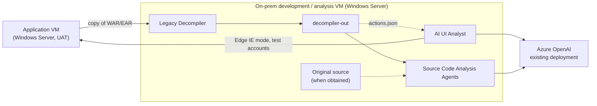

# Legacy application modernisation toolkit

Three tools that recover how a legacy Java web application works, from the deployed archive and from its user interface, and turn that into a modernisation analysis. The two AI tools use **your existing Azure OpenAI deployment**, called directly or through **Azure API Management (APIM)**, with an API key or APIM subscription key. No Azure provisioning, Azure CLI or Entra ID sign-in is needed, and nothing is sent anywhere else.

## Start here

**New to the toolkit? Follow the step-by-step [HANDOVER-GUIDE.md](HANDOVER-GUIDE.md)**: preparation checklists, the questions for your APIM team, installation, configuration and running each tool, reviewing the results, troubleshooting and close-down.

| If… | Do this |
|---|---|
| **The target Windows server has no Python or internet access** (typical application server) | Download the prebuilt zip from the [latest release](../../releases/latest). Before extracting, run `Unblock-File`, then follow its `README.md` (the same file as [release-template/README.md](release-template/README.md)). Python, pip and installation are not needed; only the APIM / Azure OpenAI endpoint must be reachable. |
| **You want to build the executables yourself** | On a connected Windows machine with Python 3.12 x64, run `.\build-release.ps1`. It produces the same `release\` folder. |
| **You prefer a Python installation on an analysis VM** | Use each package's `install.ps1` and README (below). |

**What to prepare** (details in each package's PREREQUISITES):

1. A copy of the deployed **WAR/EAR**, and Java on the machine that runs the decompiler (a portable JDK 17 ZIP is best; Java 8 works).
2. From the APIM / Azure OpenAI team: the **endpoint**, **deployment name**, **subscription key header** and a **key**. Section *Azure OpenAI behind API Management* below lists the exact questions.
3. For the UI Analyst: the **UAT URL**, **one test account per role** (no MFA or CAPTCHA), and Microsoft Edge on the machine.

**What it analyses:** Java web applications (WAR, or EAR with WARs) built on servlets/JSP. The deepest deterministic extraction covers Struts 1, Spring XML configuration, Hibernate / JPA, Quartz and `web.xml`. Other Java frameworks are decompiled and analysed by the AI agents with fewer deterministic extractions. The UI Analyst works with any browser-based application.

## The three tools

Each one has its own installer, configuration, README and **PREREQUISITES**. They can run on the same Windows machine, including the application server itself, or on separate VMs.

| Package | Folder | What it does | Uses AI | Touches the application VM |
|---|---|---|---|---|
| **AI UI Analyst** | [ui-analysis-agent](ui-analysis-agent/README.md) | Signs in as each business role through Edge (standard or IE mode). Explores the screens safely in read-only mode and checks role access. Produces a functional and UI design analysis for modernisation. | Yes (Azure OpenAI; optional Copilot SDK runtime) | Browser access to a **UAT** instance with test accounts |
| **Legacy Decompiler** | [code-decompiler](code-decompiler/README.md) | Extracts descriptors, configuration, SQL, integrations and entry points from the deployed WAR/EAR. Reconstructs the source with three decompilers and measures their fidelity. | No (deterministic, offline) | A read-only **copy** of the deployed artifact |
| **Source Code Analysis Agents** | [source-code-analysis-agent](source-code-analysis-agent/README.md) | Architect, component, cross-cutting and planner agents analyse the decompiled or original source. They produce verified business rules, findings, component assessments and a migration plan. | Yes (Azure OpenAI through the GitHub Copilot SDK runtime) | None |

## Recommended order

1. **Legacy Decompiler.** Copy the deployed artifact from the application VM and run `legacy-decompiler run`.
2. **Source Code Analysis Agents.** Run them on the decompiler output. When the original source code is obtained, run them again with `input.source_dirs` into a new `output_dir`, and compare the two reports.
3. **AI UI Analyst.** Run it on the UAT instance, with `app.declared_paths_file` pointing at the decompiler's `actions.json`, then run `ui-analyst design`.

## Prerequisites at a glance

| | AI UI Analyst | Legacy Decompiler | Source Code Analysis Agents |
|---|---|---|---|
| Windows Server 2019/2022 x64 | Desktop Experience, interactive session | Core or Desktop | Core or Desktop |
| Python | 3.12 x64 (none with the executable build) | 3.10+ (none with the executable build) | 3.12 x64 (none with the executable build) |
| Java | none | JDK 17/21 recommended (portable ZIP is fine); Java 8 JDK or JRE works with documented reductions | none |
| Browser | Edge; IE mode settings (administrator, once) and IEDriverServer for `engine = "ie"` | none | none |
| Other tools | Optional: Playwright, Copilot runtime (both in the executable build) | Optional: `syft.exe`, `gitleaks.exe` | Copilot runtime (`copilot-runtime.exe`, in the executable build) |
| Azure OpenAI (existing, direct or via APIM) | Endpoint or APIM URL, deployment (vision, structured outputs), key in `AZURE_OPENAI_API_KEY` | none | Endpoint or APIM URL, deployment (Responses API, tool calling), key in `AZURE_OPENAI_API_KEY` |
| Application VM | UAT URL, one test account per role, no MFA/CAPTCHA | Read-only copy of the deployed artifact plus SHA-256 hash | none |
| Containers / Docker | not used | not required (`runner = local`) | not used |

Each package's `check` command verifies its prerequisites and prints **READY** or **NOT READY**. For the AI packages it makes a real model call; through the Copilot runtime, that call includes a tool call.

## Azure OpenAI behind API Management

Both AI packages share these `ai` settings (details in each README):

| Key | Typical APIM value |
|---|---|
| `endpoint` | `https://<apim-gateway>/<api-url-suffix>` |
| `model` | deployment name |
| `api_style` | `deployments`: `/openai/deployments/<name>/…?api-version=` (classic import); `v1`: `/openai/v1/…`; `base_url`: OpenAI-compatible URL used as is |
| `api_version` | `2025-04-01-preview` |
| `auth_header` | `api-key` or `Ocp-Apim-Subscription-Key` (whichever the APIM API uses) |
| key | APIM subscription key in `AZURE_OPENAI_API_KEY` |

The APIM API must expose `POST …/deployments/{id}/chat/completions` (UI Analyst) and `POST …/responses` (Source Code Analysis Agents, and the UI Analyst `copilot` runtime). Reasoning models accept function tools only through the Responses API.

## Running on the application server (executables)

`build-release.ps1` (or each package's `build_exe.ps1`) creates PyInstaller **folder** builds. Nothing is unpacked to `%TEMP%`, which suits AppLocker/WDAC and antivirus; Python and pip are not needed on the server. The decompiler still needs a Java runtime. On a small server, run the tools one at a time and set the decompiler's `jdk.heap` to `1g`.

## Offline installation (no internet on the VMs)

On a connected machine:

1. Download the Python wheels: `pip download <package-folder>[extras] -d D:\wheels`.
2. Download the decompiler jars: `legacy-decompiler fetch-tools`.
3. Download the Copilot runtime (`python -m copilot download-runtime`, or `ui-analysis-agent\build_exe.ps1 -WithCopilot`).
4. Download IEDriverServer, `syft.exe` and `gitleaks.exe`.

Copy everything to the VMs. Then:

- install the packages with `install.ps1 -Wheelhouse D:\wheels`;
- set `tools_dir`, `analysis.cli_path` / `ai.copilot.cli_path`, `browser.iedriver_path`, `syft_path` and `gitleaks_path`.

## Data handling summary

- **No passwords or keys in configuration files.** Role passwords and the Azure OpenAI API key or APIM subscription key come from environment variables. The endpoint and deployment name can be typed in when the tools start. The key is sent only in the configured header; no Windows or Azure CLI identity token is ever sent to the endpoint.
- **What reaches the model.** Only your Azure OpenAI deployment (directly or through your APIM) receives content: screen text and screenshots, or sanitised code. Secret-looking values and card numbers are masked before sending. No GitHub sign-in is used and Copilot runtime telemetry is off by default.
- **Confidential outputs.** Decompiled sources and analysis outputs are confidential. Restrict folder permissions, and apply your retention policy.
