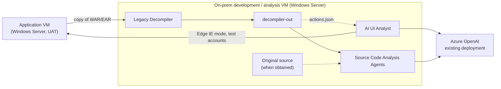

# Legacy application modernisation toolkit: handover

This toolkit contains three independent packages. Each one has its own installer, configuration, README and **PREREQUISITES** (on-premises development / analysis VM and application VM, both on Windows Server). They can be installed on the same VM or on separate VMs. The two AI packages use the customer's existing Azure OpenAI resource (endpoint, deployment name and API key); no Azure provisioning, Azure CLI or Entra ID sign-in is needed.

| Package | Folder | What it does | Uses AI | Touches the application VM |
|---|---|---|---|---|
| **AI UI Analyst** | [ui-analysis-agent](ui-analysis-agent/README.md) | Signs in as each business role through Edge (IE mode). Explores the screens safely in read-only mode and checks role access. Produces a functional and UI design analysis for modernisation. | Yes (Azure OpenAI; optional Copilot SDK runtime) | Browser access to a **UAT** instance with test accounts |
| **Legacy Decompiler** | [code-decompiler](code-decompiler/README.md) | Extracts descriptors, configuration, SQL, integrations and entry points from the deployed WAR/EAR. Reconstructs the source with three decompilers and measures their fidelity. | No (deterministic, offline) | A read-only **copy** of the deployed artifact |
| **Source Code Analysis Agents** | [source-code-analysis-agent](source-code-analysis-agent/README.md) | Architect, component, cross-cutting and planner agents analyse the decompiled or original source. They produce verified business rules, findings, component assessments and a migration plan. | Yes (Azure OpenAI through the GitHub Copilot SDK runtime) | None |

## Recommended order

1. **Legacy Decompiler.** Copy the deployed artifact from the application VM and run `legacy-decompiler run`.
2. **Source Code Analysis Agents.** Run them on the decompiler output. When the original source code is obtained, run them again with `input.source_dirs` into a new `output_dir`, and compare the two reports.
3. **AI UI Analyst.** Run it on the UAT instance, with `app.declared_paths_file` pointing at the decompiler's `actions.json`, then run `ui-analyst design`.

## Prerequisites at a glance

| | AI UI Analyst | Legacy Decompiler | Source Code Analysis Agents |
|---|---|---|---|
| Windows Server 2019/2022 x64 | Desktop Experience, interactive session | Core or Desktop | Core or Desktop |
| Python | 3.12 x64 | 3.10+ (3.12 recommended) | 3.12 x64 (3.11 minimum) |
| Java | none | JDK 17/21 and JDK 8 | none |
| Browser | Edge with IE mode, IEDriverServer | none | none |
| Other tools | Optional: Playwright, Copilot runtime | Optional: `syft.exe`, `gitleaks.exe` | Copilot runtime (`copilot-runtime.exe`) |
| Azure OpenAI (existing) | Endpoint, deployment (vision, structured outputs), API key in `AZURE_OPENAI_API_KEY` | none | Endpoint, deployment (Responses API, tool calling), API key in `AZURE_OPENAI_API_KEY` |
| Application VM | UAT URL, one test account per role, no MFA/CAPTCHA | Read-only copy of the deployed artifact plus SHA-256 hash | none |
| Containers / Docker | not used | not required (`runner = local`) | not used |

Each package's `check` command verifies its prerequisites and prints **READY** or **NOT READY**.

## Offline installation (no internet on the VMs)

On a connected machine:

1. Download the Python wheels: `pip download <package-folder>[extras] -d D:\wheels`.
2. Download the decompiler jars: `legacy-decompiler fetch-tools`.
3. Download the Copilot runtime (`python -m copilot download-runtime`, or `ui-analysis-agent\build_exe.ps1 -WithCopilot`).
4. Download IEDriverServer, `syft.exe` and `gitleaks.exe`.

Copy everything to the VMs. Then:

- install the packages with `install.ps1 -Wheelhouse D:\wheels`;
- set `tools_dir`, `analysis.cli_path` / `ai.copilot.cli_path`, `browser.iedriver_path`, `syft_path` and `gitleaks_path`.

## Data handling summary

- **No passwords or keys in configuration files.** Role passwords and the Azure OpenAI API key come from environment variables. The endpoint and deployment name can be typed in when the tools start.
- **What reaches the model.** Only the customer's Azure OpenAI deployment receives content: screen text and screenshots, or sanitised code. Secret-looking values and card numbers are masked before sending. No GitHub sign-in is used and Copilot runtime telemetry is off by default.
- **Confidential outputs.** Decompiled sources and analysis outputs are confidential. Restrict folder permissions, and apply your retention policy.
