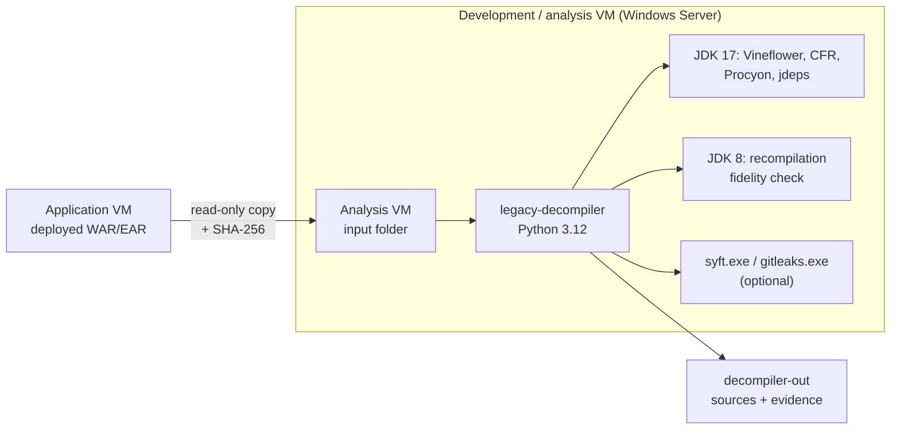

# Legacy Decompiler: prerequisites (Windows Server)

The Legacy Decompiler runs on a **development / analysis VM**. It reads a copy of the deployed artifact (WAR, EAR or JAR) and makes no calls to Azure or to any AI service. **Nothing is installed on the application VM**; you only copy the deployed artifact from it.

> **Running directly on the application server.** Use the executable build: `legacy-decompiler.exe` from `build_exe.ps1` or `..\build-release.ps1`. No Python is needed. Java is still required. A portable JDK 17 ZIP is best, but the server's own JDK 8 or even a JRE works with reduced fidelity measurement (see *Software*). Copy the artifact to a working folder rather than reading it inside the application server's deployment folder. Set `jdk.heap` to `1g`, and run outside business hours if the server is small.

## 1. Development / analysis VM

### Operating system

| Item | Requirement |
|---|---|
| OS | Windows Server 2019 or 2022, x64. Server Core works; Desktop Experience is not required. |
| Size (guidance) | 4 vCPU, 16 GB RAM. Each decompiler runs with a 2 GB Java heap (`jdk.heap`), one at a time; 1 GB is enough for mid-size applications on a small server. Free disk of about 30× the artifact size, because the three decompilations, the recompiled classes and the unpacked artifact are kept. |
| Long paths | Recommended: `HKLM\SYSTEM\CurrentControlSet\Control\FileSystem\LongPathsEnabled = 1`. Deep package trees can exceed 260 characters. Keep `output_dir` short (for example `D:\modernisation\decompiler-out`). |
| Antivirus | Decompilation writes thousands of small `.java` and `.class` files. If your security policy allows it, exclude `output_dir` from real-time scanning to avoid very slow runs. |
| Containers | **Not required.** The default `runner = "local"` uses locally installed JDKs. `runner = "docker"` exists only for workstations with a Linux container engine. |

### Software

| Software | Version / notes |
|---|---|
| Python | 3.10 or later, x64. 3.12 from python.org is recommended. Install for all users with the `py` launcher. **Not needed** with the executable build. |
| JDK for decompilation | **JDK 17 or 21 (LTS), x64**, for example Eclipse Temurin or Microsoft Build of OpenJDK. A portable ZIP extracted to a folder needs no installer and no administrator rights. It provides `java.exe` for the decompilers and `jdeps.exe`. Set `jdk.home`, or `JAVA_HOME`. Fallbacks, verified on the lab WAR: **Java 8 JDK**, where CFR and Procyon run and Vineflower (Java 11+) is skipped; and **Java 8 JRE**, where decompilation runs but recompilation and `jdeps` are skipped and reported. `check` shows these as `WARN`, not as failures. |
| JDK for recompilation | **JDK 8, x64** (for example Temurin 8). Set `jdk.recompile_home`. It recompiles each decompiled class at the application's original Java level (1.5–1.8) to measure decompiler fidelity. Without it, sources are recompiled at level 8 with the main JDK, which is less faithful for Java 5–7 code. |
| Decompiler jars | Vineflower 1.10.1, CFR 0.152, Procyon 0.6.0, plus servlet-api 2.5 and jsp-api 2.1 for recompilation. `legacy-decompiler fetch-tools` downloads them from Maven Central (SHA-1 verified) and from GitHub (Procyon), and writes `tools-manifest.json` with SHA-256 hashes. For offline VMs, run `fetch-tools` on a connected machine and copy `tools_dir`. |
| syft (optional) | `syft.exe` (Anchore, Windows x64 release) for the CycloneDX SBOM. Set `syft_path`, or add it to PATH. If it is missing, the SBOM step is skipped and reported. |
| gitleaks (optional) | `gitleaks.exe` (Windows x64 release) for the secret scan of the artifact and the decompiled code. Set `gitleaks_path`, or add it to PATH. Findings are redacted. |

Verify the published checksums of `syft.exe`, `gitleaks.exe` and the JDK installers before you approve them for the VM.

### Network (outbound from the development VM)

The tool is fully offline once the tools are staged. Outbound access is needed only to install:

| Destination | Purpose |
|---|---|
| `pypi.org`, `files.pythonhosted.org` (or an internal mirror) | Python package installation. The only dependency is `defusedxml`. |
| `repo1.maven.org`, `github.com`, `objects.githubusercontent.com` | Decompiler jar download. Not needed when `tools_dir` is staged. |

### Data protection

The decompiled sources are the application owner's intellectual property, and they may contain embedded credentials.

- Restrict NTFS permissions on `output_dir` to the modernisation team.
- `config.json` masks property values whose names look like secrets. Treat the raw `unpacked/` and `decompiled/` folders as confidential.
- Delete or archive the outputs according to your data retention policy when the engagement ends.

## 2. Application VM (where the legacy application is hosted)

**No software is installed and no restart is needed.** An application server administrator prepares a read-only copy of what is deployed.

1. **Locate the deployed artifact.** Typical locations on Windows:

   | Application server | Typical location |
   |---|---|
   | Apache Tomcat | `%CATALINA_BASE%\webapps\<app>.war`, or the exploded folder `webapps\<app>\` |
   | Oracle WebLogic | Deployment *Source Path* in the console (`config.xml` → `<app-deployment><source-path>`) |
   | IBM WebSphere | `<profile>\installedApps\<cell>\<app>.ear` |
   | JBoss / WildFly | `standalone\deployments\` |

2. **Copy the archive as deployed.** Do not use a build-server version: the decompiler must see what actually runs. Include `WEB-INF\lib`. If business code also lives in shared server libraries (for example a custom JAR in Tomcat `lib\` or a WebLogic shared library), copy those JARs too, and place them in `WEB-INF\lib` of the copy.
3. **If only an exploded folder exists**, copy the folder to the analysis VM (for example `robocopy <app-folder> D:\modernisation\input\app /E`). Repackage it there with the JDK, which writes standard ZIP entries: `jar --create --file D:\modernisation\input\app.war -C D:\modernisation\input\app .`
4. **Record integrity.** Run `Get-FileHash <artifact> -Algorithm SHA256` on both VMs and keep the values with the analysis.
5. **Collect context**, which is not read by the tool but is useful to the modernisation team. Mask secrets in it:
   - application server product and version;
   - the JVM version (`<server JDK>\bin\java -version`);
   - the context path;
   - server-level configuration outside the archive: JNDI data sources, `context.xml`, `server.xml`, scheduler and queue definitions.
6. **Transfer** over an approved secure channel, such as an SMB share restricted to the team or your organisation's file transfer tool.

## 3. Readiness checklist

- [ ] Python installed and `install.ps1` completed, **or** the `legacy-decompiler.exe` folder copied.
- [ ] Java: JDK 17/21 (`jdk.home`, portable ZIP is fine) and optionally JDK 8 (`jdk.recompile_home`); or the server's Java 8 with the documented reductions.
- [ ] `tools_dir` staged (`fetch-tools`), or internet access to Maven Central and GitHub.
- [ ] Optional: `syft.exe` and `gitleaks.exe` approved and configured.
- [ ] Artifact copied from the application VM, with matching SHA-256 hashes.
- [ ] `legacy-decompiler check --config <config>.json` prints **READY**.
