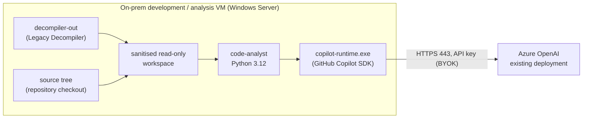

# Source Code Analysis Agents: prerequisites (Windows Server)

The Source Code Analysis Agents run on an **on-premises development / analysis VM**. They read either:

- the **Legacy Decompiler output**, or
- the **original source tree** once it is available,

and they call your **existing Azure OpenAI deployment** (API key) through the GitHub Copilot SDK agent runtime. **Nothing is installed on, or read from, the application VM.**

## 1. Development / analysis VM

### Operating system

| Item | Requirement |
|---|---|
| OS | Windows Server 2019 or 2022, x64, on-premises. Server Core works. Desktop Experience is convenient for reading the HTML report. |
| Size (guidance) | 4 vCPU, 8 GB RAM, 10 GB free disk plus 3× the size of the source or decompiled tree. |
| Session | Runs as a normal console process. For unattended runs (for example a scheduled task under a service account), set the endpoint and deployment in the config or environment, because there is no console to prompt in, and make `AZURE_OPENAI_API_KEY` available to that account. |
| Long paths | Recommended: `HKLM\SYSTEM\CurrentControlSet\Control\FileSystem\LongPathsEnabled = 1`. |

### Software

| Software | Version / notes |
|---|---|
| Python | **3.12 x64** from python.org. 3.11 is the minimum, required by the GitHub Copilot SDK. Install for all users with the `py` launcher. **Not needed** with the executable build (`build_exe.ps1`), which also ships the runtime. |
| GitHub Copilot SDK runtime | `copilot-runtime.exe`, downloaded by `install.ps1` (`python -m copilot download-runtime`) into `%LOCALAPPDATA%\github-copilot-sdk\cli\<version>\`. For offline VMs, copy that folder from a connected machine and set `analysis.cli_path` to the `copilot-runtime.exe` path. |
| Inputs | Either the Legacy Decompiler `output_dir`, or a read-only checkout of the source repository (Git, Azure DevOps, TFS or SVN). **No build or JDK is needed**: the agents only read the files. |

### Network (outbound from the development VM)

| Destination | Port | Purpose |
|---|---|---|
| Azure OpenAI endpoint, for example `<resource>.openai.azure.com`, or the **API Management gateway** (`<apim>.azure-api.net` or its custom domain) | 443 | Model calls, from `copilot-runtime.exe` (public endpoint, or a private endpoint over ExpressRoute / VPN) |
| `pypi.org`, `files.pythonhosted.org` (or an internal mirror) | 443 | Installation only |
| `github.com`, `objects.githubusercontent.com` | 443 | Copilot runtime download, at installation only. Not needed when the runtime is staged. |

- **Reaching Azure from on-premises.** If the Azure OpenAI resource restricts network access, either allow the VM's outbound public IP in the resource firewall, or use the resource's private endpoint. With a private endpoint, the on-prem DNS must resolve `<resource>.openai.azure.com` to the private IP (conditional forwarder for `privatelink.openai.azure.com`).
- **Proxy.** If outbound traffic must use a proxy, set `HTTPS_PROXY` for the account that runs the tool.
- **TLS inspection.** Add the corporate root CA to the Windows certificate store. The Copilot runtime is Node.js-based and does not read that store, so also export the CA as PEM and set `NODE_EXTRA_CA_CERTS` to its path. Confirm with `code-analyst check`, which makes a real model call (with one tool call) through `copilot-runtime.exe`.

### Azure OpenAI behind API Management

If Azure OpenAI is published through APIM, the tool calls the gateway instead of the resource:

| Setting | Value |
|---|---|
| `ai.endpoint` | Gateway URL + API URL suffix, for example `https://apim-contoso.azure-api.net/aoai` (a trailing `/openai` is accepted). |
| `ai.api_style` | `deployments` for the classic route `/openai/deployments/<name>/…?api-version=…` (an API imported from the Azure OpenAI specification or from Microsoft Foundry with *Azure OpenAI* compatibility). `v1` for *Azure OpenAI v1* compatibility. `base_url` for an OpenAI-compatible base URL used as is. |
| `ai.auth_header` | The API's subscription key header: often `api-key` for Azure OpenAI APIs, otherwise the APIM default `Ocp-Apim-Subscription-Key`. |
| Key | The **APIM subscription key**, in `AZURE_OPENAI_API_KEY`. The tool never sends a Windows or Azure CLI token to the gateway. |
| Operations | `POST /responses` (`wire_api` = `responses`, required for reasoning models with tools). Non-reasoning deployments can use `POST /deployments/{id}/chat/completions` with `wire_api` = `completions`. |
| Policies | Token-limit / rate-limit policies on the API: the agents retry HTTP 429 with back-off; size the APIM limit like the TPM quota. A response-size or timeout policy below 10 minutes can cut long agent turns. |

## 2. Application VM

**No requirements.** This package never connects to the application or its database. Its inputs are:

| Input | How to obtain |
|---|---|
| Decompiler output | Run the **Legacy Decompiler** on the artifact copied from the application VM. See that package's prerequisites. |
| Original source (when available) | A read-only checkout of the release that is deployed (tag or branch). Point `input.source_dirs` at the main Java folders (for example `src\main\java`) and `input.web_dirs` at the web and resource folders (`src\main\webapp`, `src\main\resources`). **Exclude test and generated sources.** If the decompiler output is also given, its deterministic extractions (actions, SQL strings, integration strings, dependencies) are added under `evidence/`. |

## 3. Azure OpenAI (existing resource)

No Azure provisioning, Azure CLI or Entra ID sign-in is needed. You provide three values from your existing Azure OpenAI resource (or the APIM API in front of it):

| Value | Where it goes |
|---|---|
| **Endpoint**, for example `https://<resource>.openai.azure.com` | `ai.endpoint` in the config, or the environment variable `AZURE_OPENAI_ENDPOINT`. If neither is set, `code-analyst` **asks for it** when it starts. |
| **Deployment name** | `ai.model`, or `AZURE_OPENAI_DEPLOYMENT`. Asked for at start if missing. |
| **API key** | Only in the environment variable `AZURE_OPENAI_API_KEY` (name configurable with `ai.api_key_env`). Never in the config file. |

| Item | Requirement |
|---|---|
| Deployment capabilities | A chat model that supports the **Responses API** on `/openai/v1/` with **function/tool calling**. A reasoning-capable model is recommended for architecture and planning quality. |
| Key authentication | The resource must allow API-key (local) authentication. If `disableLocalAuth` is set on the resource, key calls return HTTP 401/403. |
| API key handling | Set the key in the session that runs the tool, for example `$env:AZURE_OPENAI_API_KEY = [Net.NetworkCredential]::new('', (Read-Host -AsSecureString 'API key')).Password`. A persistent user variable (`setx`) is stored unencrypted in the user's registry profile; use it only if your policy allows. Rotate the key at the end of the engagement. |
| Quota and cost (lab reference) | 77 classes in 13 components took 236 model calls, about **6.1 M input and 0.23 M output tokens**, and about 100 minutes, which is roughly **80 K input tokens per class**. The lab deployment hit tokens-per-minute (TPM) limits in the cross-cutting and planning phases; the agents retried and completed. For a large codebase, raise the TPM quota and/or analyse in batches with `--only`. |
| Data handling | The sanitised workspace content is sent to your deployment: decompiled or original code, descriptors, JSPs and configuration. Before anything is sent, credential assignments, secret-looking property and XML values, high-entropy literals and card numbers are masked. The deployment's region and data zone determine data residency. |
| GitHub | No GitHub sign-in is used. Inference goes only to your Azure OpenAI deployment (bring your own key, BYOK), and runtime telemetry is disabled by default. Review the GitHub Copilot SDK terms with your account team before you use it in production. |

## 4. Security model of the agents

- **Read-only tools.** The agents get only the read tools `view`, `grep` and `glob`. Shell, file write and web tools are disabled.
- **Workspace confinement.** A pre-tool hook denies any path outside the analysis workspace.
- **Verified evidence.** Agents record results through `record_*` tools. Every quoted excerpt is verified against the cited file, and unverifiable evidence is rejected back to the agent.
- **Budget.** `analysis.max_model_calls` caps model calls.

## 5. Readiness checklist

- [ ] Python 3.12 x64 and `install.ps1` completed, with the Copilot runtime downloaded or staged (`analysis.cli_path` set); **or** the `code-analyst.exe` folder copied, with the runtime included.
- [ ] Azure OpenAI endpoint or APIM gateway reachable from the VM (firewall or private endpoint, DNS, proxy, `NODE_EXTRA_CA_CERTS` for TLS inspection). Deployment name, `api_style` and `auth_header` known. Key in `AZURE_OPENAI_API_KEY`. TPM quota sized.
- [ ] Input ready: the decompiler output folder and/or the source checkout.
- [ ] `code-analyst check --config <config>.json` prints **READY**.
