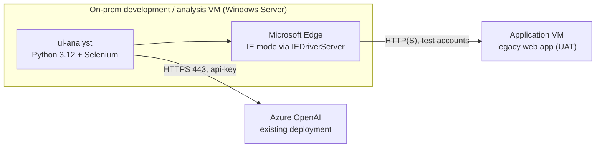

# AI UI Analyst: prerequisites (Windows Server)

The AI UI Analyst runs on an **on-premises development / analysis VM**. It signs in to the legacy application through Microsoft Edge (Internet Explorer mode or standard Edge), explores the screens of each role, and calls the customer's **existing Azure OpenAI deployment** with an API key. **Nothing is installed on the application VM.**

## 1. Development / analysis VM

### Operating system and session

| Item | Requirement |
|---|---|
| OS | Windows Server 2019 or 2022, x64, **with Desktop Experience**, on-premises. Server Core is not supported because a browser UI is required. |
| Size (guidance) | 4 vCPU, 16 GB RAM, 30 GB free disk. Screenshots use about 0.2–0.5 MB per screen. |
| Display | 1600×1000 or larger desktop resolution, with display scaling at 100%. |
| Interactive session | The analyst must run in an **interactive, signed-in desktop session**: the console or an RDP session that is **not minimised**. IEDriverServer cannot drive the browser from a Windows service, from session 0, or from a scheduled task set to "run whether user is logged on or not". Screenshots from a minimised RDP window are blank. |
| Account | A dedicated Windows account for the analysis. Local admin rights are needed only for installation and policy settings, not to run the analyst. |
| Long paths | Recommended: `HKLM\SYSTEM\CurrentControlSet\Control\FileSystem\LongPathsEnabled = 1`. |

### Software

| Software | Version / notes |
|---|---|
| Python | 3.12 x64 from python.org. Install for all users and include the `py` launcher. 3.11 is the minimum for the Copilot runtime. |
| Microsoft Edge | Stable channel, x64. The default path is `C:\Program Files (x86)\Microsoft\Edge\Application\msedge.exe`; set `browser.edge_path` if yours differs. |
| IEDriverServer | Selenium IEDriverServer 4.x, **Win32 build recommended** because typing is faster than with the x64 build. Selenium Manager downloads it automatically if github.com is reachable. Otherwise download it on a connected machine and set `browser.iedriver_path`. |
| Optional: Playwright | Only for `browser.engine = "edge"` (modern pages). Install it with `install.ps1 -WithEdgeEngine`. It uses the installed Edge (`channel=msedge`), so no browser download is needed. |
| Optional: GitHub Copilot SDK runtime | Only for `ai.runtime = "copilot"`. Install it with `install.ps1 -WithCopilot`, which downloads `copilot-runtime.exe` from GitHub. Offline alternative: stage the runtime with `build_exe.ps1 -WithCopilot` and set `ai.copilot.cli_path`. |

### Edge Internet Explorer mode (`browser.engine = "ie"`)

Apply these settings by Group Policy, or locally with an administrator account:

1. **Enable IE mode.** Set the Microsoft Edge policy *Configure Internet Explorer integration* to **Internet Explorer mode** (`HKLM\SOFTWARE\Policies\Microsoft\Edge\InternetExplorerIntegrationLevel = 1`, DWORD).
2. **Internet Explorer Enhanced Security Configuration (IE ESC).** This is on by default on Windows Server. Turn it **off for the analysis account** (Server Manager → Local Server → IE Enhanced Security Configuration → Users: Off). Alternatively, add the application URL to the *Trusted sites* zone. Otherwise pages and scripts are blocked inside IE mode.
3. **Protected Mode.** Use the same Protected Mode setting (all on or all off) for the Internet, Local intranet, Trusted sites and Restricted sites zones (Internet Options → Security). If policy prevents this, set `browser.ignore_protected_mode_settings = true` and confirm the result with `ui-analyst check`.
4. **IEDriver registry key.** This lets the driver keep its connection to the browser it starts. Create `HKLM\SOFTWARE\Wow6432Node\Microsoft\Internet Explorer\Main\FeatureControl\FEATURE_BFCACHE` with the DWORD value `iexplore.exe = 0`. Also create the same key without `Wow6432Node` if you use the x64 driver.
5. **Proxy.** By default the analyst opens the application **without a proxy** (`browser.proxy = "direct"`). Proxy auto-detection stalled session start by about 2 minutes in testing. If the application is reachable only through a proxy, set `browser.proxy` to `"host:port"` or to `"system"`.
6. **Pop-ups and downloads.** Allow pop-ups for the application URL. The analyst never downloads files.

### Network (outbound from the development VM)

| Destination | Port | Purpose |
|---|---|---|
| Application URL (UAT) | 80/443, or the application port | Browser sessions |
| Azure OpenAI endpoint, for example `<resource>.openai.azure.com` | 443 | Model calls (public endpoint, or a private endpoint over ExpressRoute / VPN) |
| `pypi.org`, `files.pythonhosted.org` (or an internal mirror) | 443 | Installation only |
| `github.com`, `objects.githubusercontent.com` | 443 | Installation only: Selenium Manager driver download and the Copilot runtime download. Not needed when both are staged. |

- **Reaching Azure from on-premises.** If the Azure OpenAI resource restricts network access, either allow the VM's outbound public IP in the resource firewall, or use the resource's private endpoint. With a private endpoint, the on-prem DNS must resolve `<resource>.openai.azure.com` to the private IP (conditional forwarder for `privatelink.openai.azure.com`).
- **Proxy.** If outbound traffic must use a proxy, set `HTTPS_PROXY` (and `NO_PROXY` for the application host) in the environment that runs `ui-analyst`.
- **TLS inspection.** If traffic is TLS-inspected, add the corporate root CA to the Windows certificate store; Python uses that store for the model calls. `ui-analyst check` confirms the connection; with `ai.runtime = "copilot"` it also tests the Copilot runtime's own HTTPS call.

## 2. Application VM (the legacy application)

**No software is installed on the application VM.** The analyst behaves like a browser user. Prepare the following:

| Item | Requirement |
|---|---|
| Environment | A **non-production** instance (UAT or SIT) with production-like reference data and masked customer data. Do not point the analyst at production. |
| Test accounts | One account per role to analyse (for example maker, checker, supervisor, admin). Each account must have exactly the access of that role, and should not be used by people during a run, because parallel sessions can log each other out. The accounts must have no MFA prompt and no CAPTCHA. For single sign-on (SSO) or Windows Integrated Authentication, use `login.mode = "sso"` and run once per role under that role's Windows account. |
| Passwords | Stored outside the configuration, in the environment variables named by `roles.<role>.password_env`. Set them in the session that runs the analyst, for example `$env:UIA_PWD_MAKER = [Net.NetworkCredential]::new('', (Read-Host -AsSecureString 'maker password')).Password`. Do not write passwords into files. |
| Account lockout | Confirm the lockout threshold. `ui-analyst check` signs in once per role. |
| Test data | Enter in `app.sample_values` a few valid identifiers (customer numbers, policy numbers) that the search screens accept. Without them, enquiry screens behind a search cannot be reached. |
| Firewall | Allow the development VM to reach the application host and port. |
| Optional | A copy of the application server access logs for the analysis window, if the team wants to correlate the analyst's sessions (`crawler-sessions.txt` lists their session IDs). |

The default safety mode `read_only` blocks buttons and links that change data: approve, save, submit, delete, pay, and so on, with English and Arabic keywords. `probe` mode submits forms with invalid inputs to learn validations. Use `probe` only on a disposable test environment, and only with the application owner's agreement.

## 3. Azure OpenAI (existing resource)

No Azure provisioning, Azure CLI or Entra ID sign-in is needed. The customer provides three values from its existing Azure OpenAI resource:

| Value | Where it goes |
|---|---|
| **Endpoint**, for example `https://<resource>.openai.azure.com` | `ai.endpoint` in the config, or the environment variable `AZURE_OPENAI_ENDPOINT`. If neither is set, `ui-analyst` **asks for it** when it starts. |
| **Deployment name** | `ai.model`, or `AZURE_OPENAI_DEPLOYMENT`. Asked for at start if missing. |
| **API key** | Only in the environment variable `AZURE_OPENAI_API_KEY` (name configurable with `ai.api_key_env`). Never in the config file. |

| Item | Requirement |
|---|---|
| Deployment capabilities | A chat model that supports **structured outputs (JSON schema)** and **image input**, which the screen analysis and design audit use. For `ai.runtime = "copilot"` it must also support the **Responses API** on `/openai/v1/`. |
| Key authentication | The resource must allow API-key (local) authentication. If `disableLocalAuth` is set on the resource, key calls return HTTP 401/403. |
| API key handling | Set the key in the session that runs the analyst, for example `$env:AZURE_OPENAI_API_KEY = [Net.NetworkCredential]::new('', (Read-Host -AsSecureString 'API key')).Password`. A persistent user variable (`setx`) is stored unencrypted in the user's registry profile; use it only if your policy allows. Rotate the key at the end of the engagement. |
| Quota | About 45K tokens per screen with the Copilot runtime, less with `direct`. Plan the tokens-per-minute (TPM) quota accordingly; the agents retry HTTP 429 responses with back-off. |
| Data handling | Page text, form structure and screenshots of the UAT application are sent to the customer's Azure OpenAI deployment. Fields that look like card numbers or secrets are masked in prompts (`safety.mask_patterns_in_prompts`). The deployment's region and data zone determine data residency. |
| GitHub | No GitHub sign-in is used. The Copilot runtime sends inference to the customer's deployment (bring your own key, BYOK), and runtime telemetry is disabled by default. Review the GitHub Copilot SDK terms with your account team before you use it in production. |

## 4. Readiness checklist

- [ ] Windows Server with Desktop Experience. Interactive session available.
- [ ] Python 3.12 x64. `install.ps1` completed.
- [ ] Edge installed. IE mode policy set. IE ESC off for the analysis account. Protected Mode consistent. `FEATURE_BFCACHE` key created.
- [ ] IEDriverServer reachable (Selenium Manager or `browser.iedriver_path`).
- [ ] Azure OpenAI endpoint reachable from the VM (firewall or private endpoint, DNS, proxy). Deployment name known. `AZURE_OPENAI_API_KEY` set.
- [ ] UAT URL reachable. Test accounts per role. Passwords in environment variables.
- [ ] `ui-analyst check --config <config>.json` prints **READY**.
